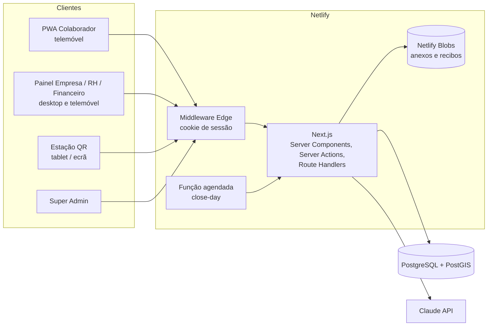
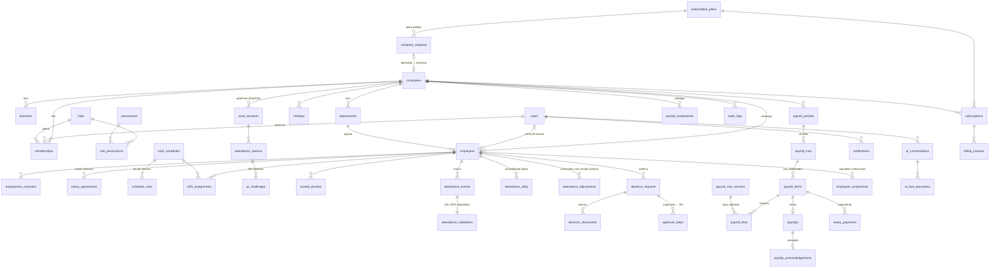

# Arquitectura do PontoSmart

## Visão geral



Camadas no código:

- `src/app` — rotas (páginas, server actions, API). Só orquestram: autenticação/permissões → validação (Zod) → domínio → `revalidatePath`.
- `src/lib/domain` — regras de negócio (marcação, assiduidade, justificações, salários, QR, geofence, auditoria, notificações). As partes puras (`geofence.ts`, `attendance-rules.ts`, `payroll/engine.ts`, `qr.ts`) não dependem da BD.
- `src/lib/auth` — sessões, palavras-passe, MFA, RBAC e contexto do pedido.
- `src/lib/db` — esquema Drizzle e ligação (preguiçosa).
- `src/lib/queries` — consultas de leitura reutilizadas pelas páginas (sempre com âmbito de empresa/equipa).
- `src/components` — UI (`ui/` primitivas estilo shadcn, `shell/` navegação, `charts/`, `maps/`).

## Árvore de pastas

```
ponto-smart/
├── drizzle/                     migrações SQL (extensões, esquema, triggers)
├── docs/ARQUITECTURA.md
├── netlify/functions/close-day.mts   tarefa diária
├── public/                      ícones PWA, service worker, página offline
├── scripts/                     migrate, seed, reset
├── src/
│   ├── app/
│   │   ├── (auth)/              login, MFA, acções de sessão
│   │   ├── app/                 portal do colaborador (mobile-first)
│   │   ├── empresa/             painel da empresa (RH, Financeiro, Supervisor)
│   │   ├── admin/               Super Admin
│   │   ├── estacao/[id]/        ecrã de QR dinâmico
│   │   ├── conta/seguranca/     palavra-passe e MFA
│   │   └── api/                 REST: auth, attendance, employees, absence-requests,
│   │                            payroll, payslips, reports, stations, ai, cron, health
│   ├── components/{ui,shell,charts,maps,attendance,pwa}
│   ├── lib/
│   │   ├── auth/                context, session, rbac, password, mfa
│   │   ├── db/                  schema.ts, index.ts
│   │   ├── domain/              attendance, attendance-rules, geofence, qr, absence,
│   │   │                        employees, audit, notifications, payroll/{engine,money,service,payslip-pdf}
│   │   ├── ai/tools.ts          ferramentas controladas do assistente
│   │   └── queries/             leituras com âmbito de empresa/equipa
│   └── middleware.ts
└── tests/                       unitários e integração
```

## Modelo de dados

Todas as tabelas de cliente têm `company_id`; chaves UUID; dinheiro em `NUMERIC(14,2)`; instantes em `timestamptz` (UTC).



Tabelas auxiliares: `sessions` (sessões revogáveis), `rate_limits` (contadores partilhados).

Garantias na base de dados (`drizzle/0002_integrity_guards.sql`): execuções aprovadas imutáveis, `audit_logs` apenas de acréscimo, verificações de datas, meses, dias da semana e raios.

## Contextos de autorização

| Papel | Âmbito |
|---|---|
| `super_admin` | Plataforma (empresas, planos, facturação, saúde). Sem permissões de empresa. |
| `owner` | Tudo na empresa. |
| `admin` | Operação da empresa; não aprova salários nem regista pagamentos; não vê salários. |
| `hr` | Colaboradores, assiduidade, justificações, preparação salarial, emissão de recibos. |
| `finance` | Consulta salarial, aprovação, recibos, pagamentos. |
| `supervisor` | Apenas departamentos que gere: assiduidade, revisão e justificações da equipa. |
| `employee` | Apenas os próprios dados. |

A fonte de verdade é `src/lib/auth/rbac.ts`; o seed espelha-a em `roles`/`permissions`/`role_permissions`.

## API REST (resumo)

| Método | Endpoint | Finalidade |
|---|---|---|
| POST | `/api/auth/login` | Autenticação (cookie de sessão) |
| POST | `/api/auth/logout` | Terminar sessão |
| GET/POST | `/api/employees` | Listar / criar colaboradores |
| POST | `/api/attendance/clock` | Registar ponto |
| GET | `/api/attendance/me?month=YYYY-MM` | Histórico próprio |
| GET | `/api/stations/:id/qr` | Novo QR dinâmico (ecrã da estação) |
| POST | `/api/absence-requests` | Justificação (multipart com anexos) |
| PATCH | `/api/absence-requests/:id` | Decisão autorizada |
| GET | `/api/absence-documents/:id` | Anexo privado |
| POST | `/api/payroll/runs` | Pré-processamento |
| POST | `/api/payroll/runs/:id/approve` | Aprovação |
| GET | `/api/payslips/:id` | Recibo PDF autorizado |
| GET | `/api/reports/attendance`, `/employees`, `/payroll/:runId` | Exportações Excel |
| POST | `/api/ai/chat` | Assistente IA |
| GET/POST | `/api/ai/executions/:id` | Documento gerado / confirmação de rascunho |
| POST | `/api/cron/close-day` | Fecho diário (protegido por `CRON_SECRET`) |
| GET | `/api/health` | Disponibilidade |

## Assistente de IA

Fornecedor: Gemini (`GEMINI_API_KEY`, modelo rápido com alternativas automáticas em caso de sobrecarga) ou Claude (`ANTHROPIC_API_KEY`). Ciclo manual de chamadas de funções em `src/lib/ai/agent.ts`, limitado a 4 rondas.


Ferramentas: `getAttendanceSummary`, `findLateEmployees`, `getAbsenceRequests`, `preparePayrollReport`, `explainPayrollCalculation`, `createNotificationDraft`, `generateDocument`.

- Cada ferramenta corre com as permissões e o âmbito (empresa/equipa) do utilizador; sem SQL livre.
- `createNotificationDraft` cria apenas um rascunho (`approval_status = pending`); o envio exige confirmação explícita no ecrã.
- Não executa pagamentos, aprovações nem sanções. Todas as execuções ficam em `ai_tool_executions`.
