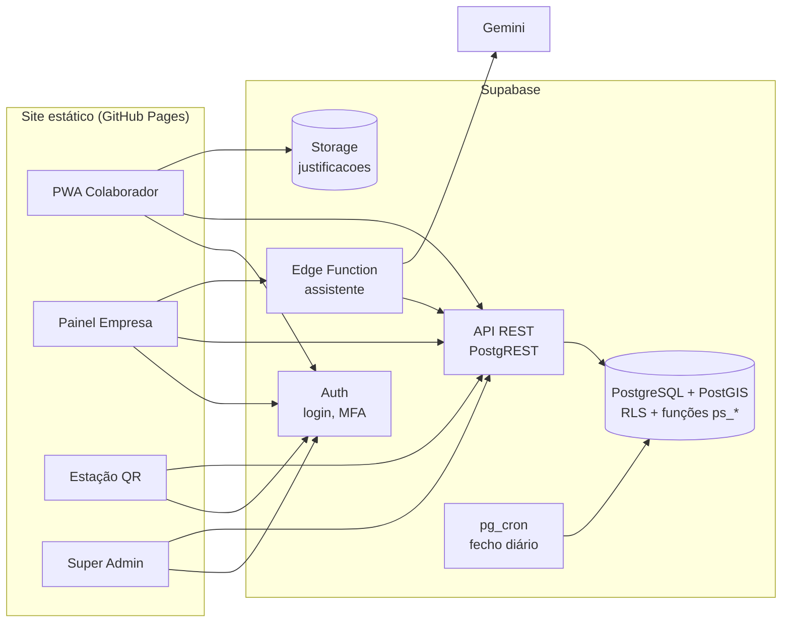
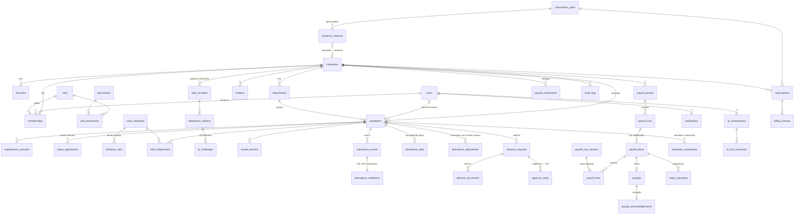

# Arquitectura do PontoSmart

## Visão geral

- `src/app` — páginas cliente (export estático, sem servidor próprio).
- `src/lib/sb` — cliente Supabase, sessão (`ps_me`), carregamento de dados.
- `src/lib/domain` — regras puras no navegador: geofence, regras de assiduidade, motor salarial (o resultado é gravado por `ps_payroll_save_run` e a aprovação confirma o hash dos dados).
- `supabase/04_parte1.sql … 04_parte5.sql` — fonte de verdade das permissões (RLS) e das operações sensíveis (`ps_clock`, `ps_station_qr`, `ps_submit_absence`, `ps_decide_absence`, `ps_create_employee`, `ps_set_access`, `ps_admin_create_company`, `ps_payroll_*`…).

## Modelo de dados

Todas as tabelas de cliente têm `company_id`; chaves UUID; dinheiro em `NUMERIC(14,2)`; instantes em `timestamptz` (UTC).

Tabelas auxiliares: `sessions` (sessões revogáveis), `rate_limits` (contadores partilhados).

Garantias na base de dados (`01_esquema.sql`): execuções aprovadas imutáveis, `audit_logs` apenas de acréscimo, verificações de datas, meses, dias da semana e raios.

## Contextos de autorização

| Papel | Âmbito |
|---|---|
| `super_admin` | Plataforma (empresas, planos, facturação, saúde). Sem permissões de empresa. |
| `owner` | Tudo na empresa. |
| `admin` | Operação da empresa; não aprova salários nem regista pagamentos; não vê salários. |
| `hr` | Colaboradores, assiduidade, justificações, preparação salarial, emissão de recibos. |
| `finance` | Consulta salarial, aprovação, recibos, pagamentos. |
| `supervisor` | Apenas departamentos que gere: assiduidade, revisão e justificações da equipa. |
| `employee` | Apenas os próprios dados. |

As permissões estão nas tabelas `roles`/`permissions`/`role_permissions` e são aplicadas pelas regras RLS e funções do `04_parte1.sql … 04_parte5.sql`.

## Assistente de IA

Edge Function `assistente` (Deno). Recebe a pergunta, obtém um resumo dos dados com `ps_ai_context` usando o login do próprio utilizador (as regras de acesso aplicam-se) e pergunta ao Gemini (`GEMINI_API_KEY`, modelo rápido com alternativas em caso de sobrecarga). Não aprova, não paga, não sanciona.
